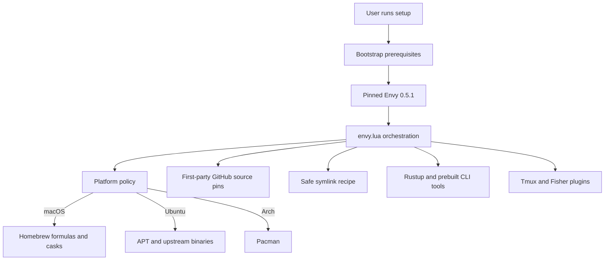
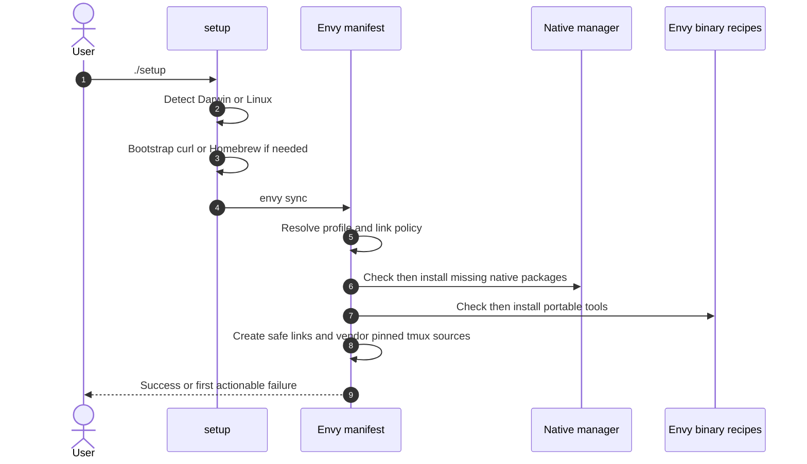

# Cross-Platform Envy Maintainer Guide

## Purpose

This repository is intended to produce one consistent development environment on macOS, Ubuntu, and Arch Linux without pretending those systems are identical. The manifest shares portable configuration and tools, maps native package names explicitly, and keeps desktop-specific configuration on the platform that owns it.

This guide records the strategy and invariants established during the cross-platform migration. Its primary audience is the next engineer or agent diagnosing a setup failure on a machine other than the one where a change was written.

### Supported baseline

| Profile | Detection | Native manager | Desktop additions | Portable fallback |
| --- | --- | --- | --- | --- |
| macOS | `envy.PLATFORM == "darwin"` | Homebrew formulas and casks | Aerospace | None currently |
| Ubuntu 24.04+ | Linux with `apt-get` and `dpkg-query` | APT | None | Upstream prebuilt Rust CLIs and official Yazi `.deb` |
| Arch Linux x86_64 | Linux with `pacman` | Pacman | None | None currently |

Pacman takes precedence if both Pacman and APT commands are visible. Other Linux distributions and Windows are deliberately unsupported.

## Goals and non-goals

The goals are:

- One `./setup` entry point on every supported platform.
- Native managers for system libraries and tools that are reliably packaged.
- Portable installers only where native repositories cannot provide a tool cleanly.
- Shared dotfiles everywhere, with explicit macOS- and Arch-only link sets.
- Idempotent reruns that preserve user-owned files and directories.
- Tests that catch package-name drift before a real installation reaches `sudo`.

The non-goals are exact package-source parity, automatic support for every APT- or Pacman-based distribution, installing unavailable Ubuntu GUI applications from third-party repositories, replacing existing dotfiles automatically, or treating CI metadata checks as full installation tests.

## Architecture

The manifest is intentionally an orchestrator. Platform decisions live in one policy module, while host mutations live in small Envy setup recipes.



### File responsibilities

| File | Responsibility |
| --- | --- |
| `setup` | Bootstraps curl/Homebrew, verifies prerequisites, then executes Envy. |
| `bin/envy` | Locates the manifest and downloads/runs the Envy version pinned by its directives. |
| `envy.lua` | Builds the package graph, common links, generated AI-skill links, and post-install plugin tasks. |
| `envy/tmux.lua` | Imports the pinned first-party GitHub helper and declares all eight vendored tmux repositories. |
| `envy/platform.lua` | Detects the profile and returns native packages, casks, and taps. |
| `envy/local.system_packages@r0.lua` | Checks and installs formulas, casks, APT packages, or Pacman packages. |
| `envy/local.symlink@r0.lua` | Classifies destinations, warns on conflicts, and creates or repairs only safe links. |
| `envy/local.yazi@r0.lua` | Fetches the pinned official Yazi `.deb`, installs it with APT, and removes legacy Cargo ownership safely. |
| `envy/local.binstall@r0.lua` | Fetches the checksum-pinned cargo-binstall bootstrap. |
| `envy/local.neovim@r0.lua` | Installs Ubuntu's latest stable upstream Neovim and verifies its release digest. |
| `envy/local.tree_sitter@r0.lua` | Installs Ubuntu's checksum-pinned upstream Tree-sitter CLI for parser builds. |
| `envy/local.binstall_tools@r0.lua` + `scripts/rust-tools` | Install/update Ubuntu's six upstream prebuilt Rust CLIs without compiling. |
| `bin/update` | Updates the active native manager and the portable tools installed for that profile. |
| `tests/` | Tests profile resolution, symlink behavior, and live native-repository metadata. |

## Setup flow

`setup` owns prerequisites that must exist before Envy can evaluate recipes. Everything else belongs in the manifest or a recipe.



GitHub dependencies use HTTPS, so a fresh public checkout does not need GitHub SSH credentials or recursive submodule initialization. Homebrew is bootstrapped only on macOS; APT and Pacman are assumed to be part of their operating systems.

## Package strategy

### Rules to preserve

1. Put shared native package names in `common_packages` only when all three managers use that exact name.
2. Put name differences in `package_aliases`. Keys are manager names (`brew`, `apt`, and `pacman`), not operating-system names.
3. Put platform-only formulas/packages in the matching profile branch.
4. Keep Homebrew GUI applications in `casks`, not `packages`, and declare required taps separately.
5. Use upstream prebuilt releases where Ubuntu packages are unavailable or too old for the selected tool versions. Keep system libraries in APT.
6. Pin fixed release archives by version and checksum. Never silently fall back to compiling Rust CLI tools.
7. Prefer official Ubuntu and Arch repositories. Do not add an AUR helper or third-party APT repository merely to force package parity.
8. When a portable tool is added, update `bin/update` if that profile installs it outside the native manager. Use scoped Envy installs for fixed release pins instead of duplicating versions in the updater.

Package names are manager-specific identifiers, not necessarily project, crate, or executable names. For example:

| Tool/executable | Homebrew | Ubuntu | Arch |
| --- | --- | --- | --- |
| GitHub CLI (`gh`) | `gh` | `gh` | `github-cli` |
| fd (`fd`) | `fd` | `fd-find` | `fd` |
| Ninja | `ninja` | `ninja-build` | `ninja` |
| typos (`typos`) | `typos-cli` | Upstream binary for crate `typos-cli` | `typos` |

The last row is an important regression case. The initial Arch profile used `typos-cli`, which is a valid crate/Homebrew name but not an official Pacman target. The correct Arch package is `typos`.

### Ubuntu fallbacks

Neovim comes from the [latest stable upstream release](https://github.com/neovim/neovim/releases/latest) on Ubuntu x86_64 and arm64, not APT. Setup and `update` resolve the current release and verify its official SHA-256 digest before installation. The complete runtime lives under `~/.local/share/neovim`, with `~/.local/bin/nvim` activating it. Existing system installations remain untouched; an unrelated executable at `~/.local/bin/nvim` causes a conflict instead of being overwritten.

The `nvim-treesitter` main branch requires Neovim 0.12+, Tree-sitter CLI 0.26.1+, `curl`, `tar`, and a C compiler. Ubuntu installs the official [Tree-sitter CLI v0.27.2 release](https://github.com/tree-sitter/tree-sitter/releases/tag/v0.27.2), checksum-pinned for x86_64 and arm64, into `~/.local/bin/tree-sitter`; APT's older CLI is not used. `build-essential` supplies the compiler. Setup and `update` use the same CLI recipe without npm or Rust compilation. macOS installs Homebrew's `tree-sitter`; Arch installs `tree-sitter-cli` and `gcc`.

Ubuntu installs `diskus`, `eza`, `git-delta`, `gping`, `hexyl`, and `typos-cli` with cargo-binstall v1.26.2. `scripts/rust-tools` owns the crate/executable mappings and upstream archive overrides for delta and gping. Only the `crate-meta-data` strategy is enabled: no QuickInstall mirror or compilation fallback. Most binaries use GNU targets; typos uses musl. Homebrew and Pacman retain ownership on macOS and Arch. Lazygit is not automatically installed on Ubuntu.

Setup migrates source-installed crates at their existing versions; `update` follows current upstream releases. These six rolling releases are not checksum-pinned in the manifest; cargo-binstall verifies upstream signatures where release metadata provides them. If an upstream binary is unavailable, installation fails rather than compiling. The cargo-binstall bootstrap itself is version- and checksum-pinned.

Yazi uses the official [v26.9.1 release](https://github.com/sxyazi/yazi/releases/tag/v26.9.1) GNU `.deb` for amd64 or arm64, checksum-pinned in `envy/local.yazi@r0.lua`. APT installs its native dependencies without adding a repository or keyring. Setup and updates retain package version `26.9.1-1`; macOS and Arch keep native-manager ownership. The GNU package requires glibc 2.39 or newer, matching the Ubuntu 24.04 baseline.

Yazi migration installs the `.deb` successfully before uninstalling registered `yazi-build`, `yazi-fm`, or `yazi-cli` packages. Recognized unregistered installer outputs are moved into a retained `.yazi-before-native.*` directory inside the Cargo installation root. Unknown manual binaries cause an explicit conflict before APT runs. The obsolete Cargo build recipes and temporary-build wrapper are removed; Rustup and `build-essential` remain development tools.

Ghostty uses native packages: a Homebrew cask on macOS, Pacman on Arch, and [the official Ubuntu package](https://ghostty.org/docs/install/binary#ubuntu) starting with Ubuntu 26.04. The Ubuntu policy reads `VERSION_ID` from `/etc/os-release`; Ubuntu 24.04 retains its configuration link without automatic Ghostty installation. No Snap or third-party repository is added.

Ghostty updates through the existing native-manager flow: Homebrew on macOS, APT on Ubuntu 26.04 or newer, and Pacman on Arch. No separate Ghostty updater is needed.

## Symlink safety contract

Regular dotfiles and generated AI-skill links go through the same recipe. A future implementation must retain this behavior:

| Destination state | Result |
| --- | --- |
| Missing | Create its parent and the symlink. |
| Correct symlink | Treat as satisfied. |
| Stale or broken symlink | Replace it safely. |
| Real file | Adopt an identical copy as a symlink; warn and preserve a differing file. |
| Real directory | Warn, preserve it, and continue; never link the source inside it. |

All shell paths must be quoted. Conflicts intentionally do not fail the entire sync because unrelated links and packages should still converge. If an older run created a nested link inside a real directory, the warning points out the possible nested path but does not remove it.

`envy/tmux.lua` uses `envy.loadenv_bundle("first-party", "lib.github")` from a commit-pinned `envy.package-specs@r11` bundle. The helper requires Envy 0.4.9. Every `github.repo` entry vendors its pinned clone to `.envy/tmux/<name>/<name>`; `envy.lua` generates links at `config/tmux/plugins/<name>` through the existing safe symlink recipe. TPM is a runtime loader only; its install/update bindings are not registered.

Normal `envy sync` installs the complete graph. The updater's `envy vendor --all` restores only declared vendor entries, without running native package or portable-tool setup. All eight revisions are reviewed manifest changes, not mutable branch heads. Cached copies provide convergence and repair after a vendored file is removed or edited.

Move any real plugin directories out of `config/tmux/plugins` before adopting managed links. Preserve modified clones. A user-owned `~/.config/tmux` remains untouched.

Common links apply to all supported profiles. On macOS, Envy links `~/.aerospace.toml` and the private helper `~/.config/aerospace/aerospace-move`. The helper is not on `PATH`.

In AeroSpace main mode, Ctrl+Cmd+h/j/k/l moves the focused Rex pane when its window is the only window on the focused monitor's presented workspace. Otherwise, the shortcut moves the focused window in AeroSpace. Windows on other monitors or hidden workspaces do not count. The Rex path requires one connected Rex app with Remote Control enabled; a Rex error does not trigger an AeroSpace move. Service mode still joins AeroSpace windows with the same keys.

AeroSpace uses config version 2. Workspaces 1–5 persist when empty; 6–9 are available on demand. The config includes disabled experiments. Enable one at a time and replace the active line when trying an alternate binding.

## Bash startup

Envy links `config/shellrc/bashrc` to `~/.bashrc` on all supported platforms and to `~/.bash_profile` for login Bash on macOS. On Ubuntu and Arch, existing login files stay in charge and must source `~/.bashrc` for interactive login shells. When no login file is available, setup links `~/.bash_profile` to the same Bash script. Setup updates existing managed links to the current checkout paths.

The managed script adds existing user tool directories and, on macOS, Homebrew's `bin` and `sbin` to `PATH` without adding duplicates. It preserves existing editor settings and defines aliases only for interactive Bash. Put machine-specific exports in `~/.config/local_config.bash`; keep those commands safe to source more than once. Fish uses its own startup configuration.

Ubuntu's stock `~/.profile` can add `~/bin` and `~/.local/bin` again after `~/.bashrc` runs. The managed Bash script does not add further copies when sourced again.

Setup removes only obsolete `~/.profile` and `~/.config/shell/environment` symlinks pointing to their former sources in this checkout. If you have a different regular `~/.bashrc` or macOS `~/.bash_profile`, setup warns and preserves it. Move any needed settings into the local Bash config, move the conflicting file to a backup, and rerun setup to install the link.

## Validation workflow

Run the non-mutating checks before a full setup:

```sh
./bin/envy lua tests/platform_test.lua
./bin/envy lua tests/local_specs_test.lua
./bin/envy lua tests/binstall_tools_test.lua
./bin/envy lua tests/yazi_setup_test.lua
./bin/envy lua tests/tree_sitter_setup_test.lua
./bin/envy lua tests/symlink_test.lua
./bin/envy lua tests/tmux_setup_test.lua
./bin/envy lua tests/omp_setup_test.lua
OMP_TEST_PLATFORM=Linux ./bin/envy lua tests/omp_setup_test.lua
bash -n setup bin/update scripts/rust-tools tests/package_metadata.sh
git diff --check
```

The updater tests execute the real script with isolated command doubles, covering propagated failures, continued later work, scoped portable-tool installs, and Envy vendoring for managed tmux configuration. Migration tests cover retained old installations on failure and ownership boundaries. These checks do not upgrade the host or access the network. Never run the live updater as a validation check. Tmux dependency checks use the real Envy helper with immutable public GitHub revisions in disposable directories.

Arch CI installs `diffutils` for byte-exact clipboard checks with `cmp`. The Herdr inventory audit uses C-locale ordering; chord checks exclude bindings intentionally removed from the configuration.

Then validate the active repository metadata without installing the packages:

```sh
tests/package_metadata.sh macos   # on macOS
tests/package_metadata.sh ubuntu  # on Ubuntu 24.04+
tests/package_metadata.sh arch    # on Arch
```

The metadata test generates its package list from `envy/platform.lua`; do not duplicate the list in shell. `tests/package_list.lua` must terminate every `envy.stdout` record with `\n`. A missing newline previously concatenated every package into one stream, caused the shell loop to perform zero useful checks, and allowed an invalid Arch package name to pass.

On macOS, the metadata check registers and explicitly trusts declared Homebrew taps before querying formulas and casks. It does not install packages.

After the non-mutating checks pass, run `./setup` on the target platform and then run it a second time. The first run validates real installation and password/permission behavior; the second validates idempotency. Do not call a platform supported solely because metadata lookup passed.

GitHub Actions runs policy, symlink, syntax, and native metadata checks on Ubuntu 24.04, macOS 15 (Apple Silicon), and an Arch container. These jobs query package repositories but do not fully provision a machine. GitHub retired macOS 14 runners on [November 2, 2026](https://github.com/actions/runner-images/issues/15226); keep the workflow on a supported pinned runner label.

The workflow runs on pull requests and pushes to `main`, subject to its path filters. Feature-branch pushes do not start a second run alongside pull-request checks.

## Troubleshooting

### Neovim Tree-sitter installation fails

Rerun `./setup` to install the CLI and compiler dependencies. To repair only Ubuntu's CLI without running the complete setup:

```sh
./bin/envy install local.tree_sitter@r0
tree-sitter --version
```

Restart Neovim and open a file with the affected filetype. Neovim installs missing supported parsers in the background and enables highlighting in open buffers when installation finishes. Use `:checkhealth nvim-treesitter` to check requirements and `:TSUpdate` to update installed parsers. The CLI must be on Neovim's `PATH`; do not install it through npm.

### Native manager reports “target/package not found”

1. Copy the exact manager command and package name from the Envy error.
2. Query that platform directly:

   ```sh
   pacman -Si PACKAGE
   apt-cache show PACKAGE
   brew info --formula PACKAGE
   brew info --cask PACKAGE
   ```

3. Search for the executable/project under its platform-specific name.
4. Correct `envy/platform.lua`; do not special-case the installer recipe for a single package.
5. Add an explicit assertion to `tests/platform_test.lua` when the alias is non-obvious.
6. Run the complete metadata test, then retry `./setup`. Envy checks installed state, so a failed partial run is safe to rerun.

### `sudo` authentication fails

Treat authentication and package resolution as separate failures. Retry with a valid password, but inspect any manager error printed after authentication. Envy deliberately uses interactive execution for APT and Pacman so `sudo` can prompt through the terminal.

### Homebrew formula/cask failure

Confirm whether the item is a formula or cask and whether it requires a tap. `brew list --formula`, `brew list --cask`, and `brew tap` are checked separately by the system-package recipe.

### Cargo or uv is missing during the same sync

The dependent recipes look in `~/.cargo/bin` and `~/.local/bin` as well as `PATH`, because installers cannot always update the already-running Envy process environment. Preserve that behavior when changing installers.

### An existing directory produces a symlink warning

This is expected safety behavior. Inspect the destination, merge or move its contents manually, remove the conflicting destination only when it is safe, and rerun setup. Never change the recipe to use a recursive or forced replacement for real directories.

### Envy recipe failure

Use the spec identity, phase, options, command, and stderr included in Envy's error. Load the manifest and individual specs without installing anything:

```sh
./bin/envy lua envy.lua
for file in envy/local.*@r0.lua; do
  ./bin/envy lua "$file" || break
done
```

## Change checklist

When changing platform behavior:

- Update the policy in `envy/platform.lua`, keeping `envy.lua` orchestration-only.
- Update the profile assertions in `tests/platform_test.lua`.
- Run `tests/package_metadata.sh PROFILE` on the affected operating system.
- Update `bin/update` if the install source is not the native manager.
- Keep public GitHub dependencies on HTTPS and use the first-party helper instead of Git submodules.
- Keep GitHub source pins as full SHAs and mirror them in `bin/update` when the tool also has an update command.
- Update this guide when an invariant, supported baseline, or fallback changes.

## Session history and current validation status

The cross-platform migration:

- Upgraded the local Envy recipes to the Envy 0.0.64 `USER_MANAGED`/named `SETUP` model.
- Replaced separate Brew, APT, and Pacman recipes with one system-package recipe.
- Centralized platform package and desktop-link decisions.
- Added macOS Homebrew bootstrap and cross-platform submodule initialization.
- Moved GitHub-sourced Cargo tools to first-party `envy.github@r0` source pins.
- Added official-installer paths for Rustup and uv plus Cargo fallbacks for Ubuntu.
- Unified dotfile and AI-skill linking under the safe conflict policy.
- Added macOS, Ubuntu, and Arch CI metadata coverage.
- Corrected Arch `typos-cli` to `typos` and fixed the metadata test that initially missed it.

Local validation has covered policy resolution, symlink states, Lua spec loading, shell syntax, workflow YAML parsing, and the complete Arch package metadata list. A future maintainer should record full clean-machine results for macOS and Ubuntu when they are available; CI metadata success alone is not proof of a successful end-to-end setup.

## Agent handoff template

When handing an unresolved platform failure to another agent, include:

```text
Platform/profile:
OS version and architecture:
Fresh machine or existing dotfiles:
Commit under test:
Command executed:
First failing Envy spec and phase:
Exact generated command:
Complete stdout/stderr:
Native metadata query and result:
Tests already run:
Files changed during diagnosis:
Whether rerunning setup is safe:
```

Start with the first failing spec, not later cascading errors. Preserve the user's existing files, avoid full-system mutations during diagnosis, and keep platform decisions centralized in the policy module.
